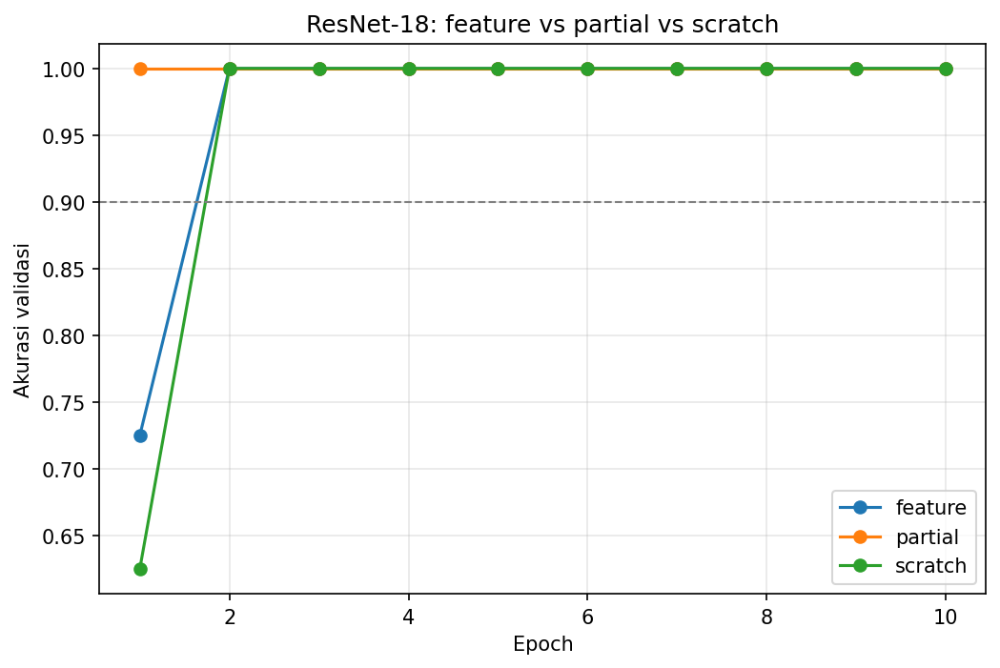

# Praktikum P2 RET503: Transfer Learning ResNet-18 (chair vs door)

**Nama:** Siti Robbiah Al-Hidayah | **NIM:** 4222401071

Repo ini berisi hasil praktikum Pertemuan 3: membandingkan tiga cara melatih ResNet-18 (feature, partial, scratch) untuk mengenali dua kelas objek, **chair** (kursi) dan **door** (pintu), lalu mengukur latensi model.

## Isi repo

```
.
├── RET503_Transfer_Learning_AMR.ipynb   # seluruh kode, jalankan dari atas ke bawah
├── dataset_raw/
│   ├── chair/                           # 100 gambar
│   ├── door/                            # 110 gambar
│   └── metadata.csv                     # nama_file, kelas, tanggal, kondisi_cahaya, sumber
├── hasil/
│   ├── hasil_3_mode.csv
│   ├── grafik_akurasi.png
│   └── hasil_latensi.csv
└── README.md
```

## 1. Dataset

| Kelas | Jumlah | Sumber |
|---|---|---|
| chair | 100 | Wikimedia Commons (pencarian "chair furniture", diunduh lewat API) |
| door | 110 | Google Drive (subfolder test/Closed 20, test/Open 20, test/Semi 20, train/Closed 50) |

Keduanya memenuhi syarat minimal 50 citra per kelas.

**Catatan jujur tentang data:**
- Data ini berasal dari sumber publik, **bukan** diambil dengan kamera robot di lingkungan operasi (slide 21). Kolom `kondisi_cahaya` di `metadata.csv` berisi `tidak_diketahui`, dan kolom `tanggal` adalah tanggal file diunduh.
- Gambar chair dari pencarian otomatis, jadi sebagian bisa saja bukan foto kursi biasa (misalnya ilustrasi atau barang museum).
- Kelas door gabungan dari gambar pintu tertutup, setengah terbuka, dan terbuka.

**Pembagian train/val:** 80% train dan 20% val, dibagi per **blok 10 file berurutan** (bukan acak per gambar), dengan `SEED = 42`. Alasannya, gambar dengan nomor berurutan (misalnya `door0000101`, `door0000102`) hampir sama, jadi kalau dipisah acak, gambar yang mirip bisa masuk ke train dan val sekaligus (data leakage, slide 24). Semua gambar diseragamkan menjadi JPG 256×256 supaya model tidak bisa membedakan kelas dari format atau ukuran file.

| Split | chair | door |
|---|---|---|
| train | 80 | 90 |
| val | 20 | 20 |

## 2. Eksperimen: tiga mode ResNet-18

Pengaturan mengikuti slide 23: optimizer Adam, CosineAnnealingLR, 10 epoch, batch 16. Augmentasi train: RandomResizedCrop, HorizontalFlip, ColorJitter.

| Mode | Bobot awal | Yang dilatih | Learning rate |
|---|---|---|---|
| feature | ImageNet | fc saja | 1e-3 |
| partial | ImageNet | layer4 + fc | 1e-4 / 1e-3 |
| scratch | acak | semua | 1e-3 |

### Hasil

| Mode | Akurasi val terbaik | Waktu latih (detik) | Epoch pertama akurasi ≥ 90% | Akurasi epoch 1 |
|---|---|---|---|---|
| feature | 1.000 | 19.4 | 2 | 0.725 |
| partial | 1.000 | 26.4 | 1 | 1.000 |
| scratch | 1.000 | 13.2 | 2 | 0.625 |



Confusion matrix model terbaik pada set validasi (baris = kelas sebenarnya, kolom = tebakan):

|  | pred chair | pred door |
|---|---|---|
| **chair** | 20 | 0 |
| **door** | 0 | 20 |

## 3. Latensi

Diukur dengan input 1×3×224×224, 20 kali pemanasan, lalu rata-rata 100 kali inferensi, di Google Colab (GPU Tesla T4 dan CPU Colab).

| Model | Device | Parameter (juta) | ms per frame | FPS |
|---|---|---|---|---|
| ResNet-18 | GPU | 11.7 | 3.7 | 273.9 |
| ResNet-18 | CPU | 11.7 | 152.6 | 6.6 |
| MobileNetV3-Small | GPU | 2.5 | 12.7 | 79.0 |
| MobileNetV3-Small | CPU | 2.5 | 25.4 | 39.4 |

Anggaran inferensi pada slide 16 adalah **35 ms per frame** (target 15 FPS).

**Model yang dipilih untuk deployment: MobileNetV3-Small**, karena di CPU hanya 25.4 ms sehingga muat di anggaran 35 ms. ResNet-18 di CPU (152.6 ms) melewati anggaran, jadi hanya layak kalau robot memakai GPU.

Catatan: (1) pengukuran di Colab, bukan di perangkat robot sebenarnya, jadi angkanya hanya perkiraan. (2) Waktu CPU Colab tidak stabil: pada run lain, ResNet-18 di CPU terukur sekitar 57 ms. (3) Akurasi di atas hanya diukur untuk ResNet-18. MobileNetV3-Small baru diukur latensinya dan belum dilatih pada dataset ini.

## 4. Analisis singkat

1. **Ketiga mode mencapai 100% akurasi validasi.** Perbedaannya hanya pada kecepatan belajar: `partial` sudah ≥ 90% di epoch 1, `feature` dan `scratch` di epoch 2. Kalau dilihat dari epoch 1, mode dengan bobot ImageNet (feature 0.725 dan partial 1.000) memulai lebih baik daripada `scratch` (0.625), sesuai dugaan bahwa bobot pralatih memberi titik awal yang lebih baik.
2. **Mode `scratch` ikut 100% dalam 2 epoch.** Itu tanda bahwa tugas ini terlalu mudah, sehingga ketiga mode tidak bisa dibedakan dengan adil. Penyebab yang mungkin: kursi dan pintu bentuknya sangat berbeda, dan kedua kelas berasal dari sumber yang berbeda (Wikimedia dan Google Drive), sehingga model bisa saja memanfaatkan perbedaan gaya gambar, bukan hanya bentuk objek.
3. **Set validasi kecil** (40 gambar), jadi satu kesalahan saja sudah menurunkan akurasi 2,5%. Model terbaik juga dipilih berdasarkan set validasi yang sama, jadi angka 100% cenderung optimis.
4. **`partial` paling lama dilatih (26.4 detik)** karena `layer4` ikut dihitung gradiennya. `scratch` tercepat (13.2 detik) di sini karena kebetulan konvergen cepat, bukan karena lebih efisien secara umum.
5. **Latensi:** untuk robot tanpa GPU, MobileNetV3-Small yang muat di anggaran 35 ms. ResNet-18 cepat di GPU (3.7 ms) tetapi terlalu lambat di CPU.

## 5. Keterbatasan dan rencana berikutnya

- Ambil data langsung dengan kamera robot (jarak, cahaya, sudut, dan latar yang bervariasi, slide 21) supaya uji lebih realistis.
- Perbesar set validasi dan pisahkan satu set uji yang tidak dipakai untuk memilih model.
- Latih MobileNetV3-Small pada dataset yang sama dan bandingkan akurasinya dengan ResNet-18.
- Ukur latensi pada perangkat robot yang sebenarnya.

## 6. Cara menjalankan ulang

1. Buka `RET503_Transfer_Learning_AMR.ipynb` di Google Colab.
2. Pilih **Runtime → Change runtime type → T4 GPU**.
3. Jalankan **Runtime → Run all**. Data door diunduh dari Google Drive dan data chair dari Wikimedia secara otomatis.
